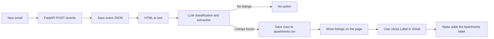

# Apartment Listing Assistant

A personal project built on the [Week 3](https://github.com/lindseypeng/ai-personal-assistant/blob/week-3/README.md) email workflow. It checks every incoming email for apartment listings, extracts the details of each listing, and keeps them in one place.

## What It Does

1. **Classify:** An LLM decides whether each new email contains apartment listings, with a confidence score.
2. **Extract:** For each listing in the email, it pulls out the price, currency, location, size, rooms, move-in date, and link. Digest emails with many listings give one entry per listing.
3. **Save:** Listings are appended to `requests/apartments.csv`, one row per listing. Re-processing an email doesn't add duplicates.
4. **Show:** `http://localhost:8000` lists each email with its listings and links.
5. **Label:** A **Label in Gmail** button adds an `Apartments` label to the email after you confirm.

## Before You Start

This branch uses the same email capture setup as Week 2 and Week 3:

1. **Start a Cloudflare tunnel.** Install it once with `brew install cloudflared` (Windows: `winget install --id Cloudflare.cloudflared`), then run `cloudflared tunnel --url http://localhost:8000` in a separate terminal and keep it open.
2. **Start `main.py`:** `cd app` then `uv run main.py`.
3. **Update the webhook.** The tunnel gets a new `trycloudflare.com` URL every time it starts, so delete the old webhook in the Nylas Dashboard, update `SERVER_URL`, create a new webhook, and restart `main.py` to load the new secret. See [Start a New Session](docs/start-new-session.md) for each step.
4. **Add `OPENAI_API_KEY` to `.env`.**

If emails stop arriving, see the [Webhook Troubleshooting Guide](docs/webhook-troubleshoot-guide.md).

## Workflow



**Why HTML to text:** Listing emails are mostly HTML styling. A digest can be over 100,000 characters of HTML but only about 13,000 characters of text. The workflow strips the HTML, keeps each link's URL next to its text, and sends the text to the LLM, so every listing in the email fits.

**What the LLM returns:** The Pydantic model `ApartmentCheck` has `is_listing`, `confidence`, and a list of `Listing` entries. OpenAI structured output makes the LLM return data in exactly this shape. Details the email doesn't state are left empty, not guessed.

## Run It

The workflow lives in `app/workflows/apartment_workflow.py`.

**In the browser:** With `main.py` and the tunnel running, refresh `http://localhost:8000` after a new email arrives. Emails with listings show each listing and a **Label in Gmail** button.

**From the terminal:** Run the workflow on one saved event. Use a file name from `requests/events/` without `.json`:

```bash
uv run app/workflows/apartment_workflow.py <event_id>
```

The script prints each listing, saves them to the CSV, then asks before labeling the email in Gmail.

## Saved Listings

`requests/apartments.csv` has one row per listing with these columns:

| Column | Description |
|--------|-------------|
| `email_id` | Nylas ID of the email the listing came from |
| `listing_number` | Position of the listing within that email |
| `date` | When the email was received, as a Unix timestamp |
| `from`, `subject` | Sender and subject of the email |
| `price`, `currency` | Rent or sale price |
| `location` | City, district, or address |
| `size_sqm`, `rooms` | Size in square meters and number of rooms |
| `move_in_date` | Available from, as written in the email |
| `link` | URL to the listing |

The CSV is excluded from Git because it contains content from your emails.

## Things to Know

- **Every incoming email is checked.** There is no sender filter on this branch, so the sender, subject, and text of every new email are sent to OpenAI.
- **Details come from the email only.** The workflow doesn't open listing links. Getting full details from listing pages would need a separate scraper, and many property sites restrict scraping in their terms of use.
- **Labels, not moves.** The `Apartments` label is added alongside the email's existing labels. The email stays in your inbox, and you can remove the label in Gmail at any time.
- **The page resets on restart.** Results on `http://localhost:8000` are kept in memory. Saved listings stay in the CSV.
- **Protect the app before running it long term.** The tunnel makes the whole app public, including the label endpoint.

## Next Steps

- Store listings in Postgres instead of a CSV
- Filter or rank listings by price, size, or location
- Follow listing links for full details, where the site allows it
