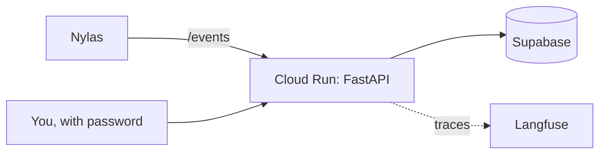

# Week 6: Observe and Evaluate the Assistant

See what the assistant does with every email, and measure how often its AI judge is right.

## Goals

1. Trace every LLM call with [Langfuse](https://langfuse.com), one trace per email.
2. Check the judge ("is this email a listing?") against emails you labeled yourself.
3. Use the saved data in Supabase to find where the assistant makes mistakes.

The deployment itself is unchanged from [Week 5](https://github.com/lindseypeng/ai-personal-assistant/tree/week-5), which has the full deploy steps.

## Live Deployment

| | |
|---|---|
| App | [assistant-26484711792.europe-west3.run.app](https://assistant-26484711792.europe-west3.run.app) (any username, password is `APP_PASSWORD`) |
| Cloud Run | Service `assistant`, project `ai-personal-assistant-lp`, region `europe-west3` |
| Database | Supabase, Central EU (Frankfurt), table `listings` |
| Traces | Langfuse Cloud, EU region |



## What a Trace Shows

Each email becomes one trace named `email`:

| Step | What you see |
|---|---|
| `email` | Sender and subject in, the decision out: `is_listing`, confidence, listings found and saved |
| `triage` | Whether the **domain rule** or the **LLM** decided, from sender and subject only |
| `extract` | The LLM call with the email text, plus `text_chars` and `truncated` (emails over 40,000 characters are cut) |
| embeddings | One call per saved listing |

Each trace also has an `is_listing` score, so you can filter and chart the decisions. Questions to `/ask` become a trace named `ask`, with the retrieved listings under `retrieve`.

Traces include email text, so keep the Langfuse project private.

## Set Up Langfuse

1. Sign up at [cloud.langfuse.com](https://cloud.langfuse.com) in the **EU** region and create a project.
2. Under **Settings**, **API Keys**, create a key pair and add it to `.env`:

```
LANGFUSE_PUBLIC_KEY=pk-lf-...
LANGFUSE_SECRET_KEY=sk-lf-...
LANGFUSE_BASE_URL=https://cloud.langfuse.com
```

3. Install the new package with `uv sync`. Without keys the app still runs, it just sends no traces.

The code change is small: `from langfuse.openai import OpenAI` replaces `from openai import OpenAI`, and `@observe` marks each step.

## Evaluate the Judge

Every judge needs an answer key. Label your saved emails in `requests/labels.json` (Git ignores it, since it points to personal email):

```json
{"<file name in requests/events without .json>": true}
```

Then run:

```bash
cd app && uv run evals/judge_eval.py
```

It runs triage and extraction on each email, prints a confusion matrix, and saves nothing to the database. Each email becomes a trace tagged `eval` with a `correct` score, so you can open the wrong ones in Langfuse and read why.

- **Precision**: of the emails the judge called listings, how many really were.
- **Recall**: of the real listing emails, how many the judge found. Triage misses are lost for good, so recall matters most there.

### Results, November 7

| Data | Result |
|---|---|
| 14 labeled local emails (5 listings, 9 not) | 14 of 14 correct, precision and recall 100% |
| Supabase, 109 emails the judge kept | 108 real listing emails and 1 test email, precision 100% |

The first run scored 13 of 14. The "mistake" was a wrong label: a search confirmation email also contained listings. Check your labels before you blame the model.

Supabase only stores emails the judge kept, so it cannot measure recall. The traces can: every "no" now shows up in Langfuse.

### Extraction quality in Supabase

The judge is reliable. The weaker part is extraction:

- 1,206 of the 1,253 listings announced in email subjects were saved (96%). Two "30 Angebote" emails kept only 11 and 12.
- Currency is written as both `EUR` and `€`.
- 62 listings have no price, and 34 cost more than the 1,500 € limit of the search alert (likely warm rent instead of cold rent).

The `truncated` field in each `extract` trace will show whether the 40,000 character limit explains the missing listings.

## Deploy Changes

Store the two keys as secrets and let the app's service account read them:

```bash
printf '%s' 'pk-lf-...' | gcloud secrets create langfuse-public-key --data-file=-
printf '%s' 'sk-lf-...' | gcloud secrets create langfuse-secret-key --data-file=-
for s in langfuse-public-key langfuse-secret-key; do
  gcloud secrets add-iam-policy-binding $s --role=roles/secretmanager.secretAccessor \
    --member=serviceAccount:assistant-run@YOUR_PROJECT_ID.iam.gserviceaccount.com
done
```

Add `LANGFUSE_BASE_URL: "https://cloud.langfuse.com"` to `cloudrun.env.yaml`, then deploy as in Week 5 with two more secrets:

```bash
gcloud run deploy assistant --source . --region europe-west3 \
  --allow-unauthenticated --no-cpu-throttling --max-instances 1 \
  --env-vars-file cloudrun.env.yaml \
  --service-account assistant-run@YOUR_PROJECT_ID.iam.gserviceaccount.com \
  --set-secrets=OPENAI_API_KEY=openai-api-key:latest,NYLAS_API_KEY=nylas-api-key:latest,DATABASE_URL=database-url:latest,APP_PASSWORD=app-password:latest,WEBHOOK_SECRET=webhook-secret:latest,LANGFUSE_PUBLIC_KEY=langfuse-public-key:latest,LANGFUSE_SECRET_KEY=langfuse-secret-key:latest
```

## Read the Supabase Data Locally

To query the live database from your laptop, copy its connection string from Secret Manager into `.env` without printing it:

```bash
printf '\nSUPABASE_DATABASE_URL=%s\n' "$(gcloud secrets versions access latest --secret=database-url --project=YOUR_PROJECT_ID)" >> .env
```

It has its own name, so `DATABASE_URL` still points to your local Docker database.
