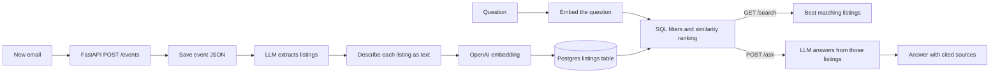

# Week 4: Postgres, pgvector, and RAG

This week we store data in Postgres, search it by meaning with pgvector, and add an LLM that answers questions from what it finds (RAG: Retrieval-Augmented Generation).

## The Example Data: Apartment Listings

The examples use apartment listings from the instructor's own side project. It reads apartment alert emails from sites like ImmobilienScout24, and an LLM extracts each listing's title, price, size, rooms, location, and link. One email can hold many listings. You don't need that project to follow along: the practice scripts include made-up sample listings, and the same ideas apply to any data you capture with Nylas.

## Data Schema

Before creating a table, decide what one row represents and which columns it needs. Here, **one row is one listing**, not one email, because we search and cite individual listings.

The fields come from the Pydantic model `Listing` in `app/schemas/listing_schema.py`, the same shape the LLM returns. The table `listings` in `app/database/models.py` stores those fields, plus columns to trace each row back to its email and the columns needed for vector search.

| Column | Type | Purpose |
|--------|------|---------|
| `id` | integer, primary key | Unique row id |
| `email_id` | text | Nylas id of the email the listing came from |
| `listing_number` | integer | Position of the listing in that email. Together with `email_id` it is unique, so re-processing an email adds no duplicates. |
| `email_date` | bigint | When the email arrived, as a Unix timestamp |
| `subject` | text | Email subject |
| `title` | text | Listing headline, for example "Helle 2-Zimmer-Wohnung mit eigenem Garten" |
| `price`, `currency` | float, text | Rent or sale price |
| `location` | text | City, district, or address |
| `size_sqm`, `rooms` | float | Size in square meters and number of rooms |
| `move_in_date` | text | Available from, as written in the email |
| `link` | text | URL to the listing |
| `content` | text | The text we embed, built from the fields above by `listing_to_text` |
| `embedding` | vector(1536) | The embedding of `content` |
| `created_at` | timestamp | When the row was stored |

Design choices worth noticing:

- **Listing fields can be empty.** The LLM leaves out details the email doesn't state, so only the source columns and the embedding are required.
- **Normal columns for filters, a vector for meaning.** `price` and `rooms` are numbers so SQL can filter them exactly. `title` and `location` feed the embedding so search can match by meaning.
- **`content` is stored next to its embedding,** so you can always see which text produced a vector.
- **`vector(1536)` must match the embedding model.** `text-embedding-3-small` returns 1536 numbers.
- **An HNSW index on `embedding`** makes similarity search fast as the table grows.

## Workflow



`/search` is the Retrieval step. `/ask` adds Generation: the retrieved listings are numbered and given to the LLM, which answers using only those listings and returns the numbers it used as `sources`.

## Run Once

1. **Fill in `.env`** from `.env.example`: `OPENAI_API_KEY` and `DATABASE_URL`.
2. **Install packages:** `uv sync`
3. **Start the database:** `docker compose up -d`. If port 5432 is taken by another project, set `POSTGRES_PORT=5434` in `.env` and use `localhost:5434` in `DATABASE_URL`.
4. **Practice (recommended):** follow the [pgvector practice](week4/pgvector-setup/README.md) to see the raw SQL behind the app.
5. **Create the table:** `uv run app/database/create_tables.py`
6. **Load the emails you already captured:** `uv run app/database/load_events.py`. Run it again if emails arrived while the app was stopped.

## Every Time

1. **Start the database:** `docker compose up -d`
2. **Start the app** and keep the terminal open: `cd app` then `uv run main.py`
3. **To receive new emails,** start the tunnel and update the webhook as in [Start a New Session](docs/start-new-session.md).
4. **Search or ask** at `http://localhost:8000/docs`, or:

   ```bash
   curl "http://localhost:8000/search?q=garden+flat+with+terrace&max_price=1500&min_rooms=2"

   curl -X POST http://localhost:8000/ask \
     -H "Content-Type: application/json" \
     -d '{"question": "Which flats would suit a couple on a small budget?"}'
   ```

   Or ask from the terminal without the app: `uv run app/workflows/ask_workflow.py "Is there a flat with a garden?"`

To stop, press Ctrl+C on `main.py`, then run `docker compose down`. Your data is kept.

## Code Map

| File | What it does |
|------|--------------|
| `docker-compose.yml` | Runs Postgres 17 with pgvector |
| `app/schemas/listing_schema.py` | Listing and API models, and `listing_to_text` |
| `app/database/models.py` | The `listings` table |
| `app/database/create_tables.py` | Enables pgvector and creates the table |
| `app/database/repository.py` | `save_listings` and `search_listings` |
| `app/database/embedding.py` | `create_embedding` |
| `app/database/load_events.py` | Loads listings from saved events |
| `app/workflows/apartment_workflow.py` | Extracts listings from an email and saves them |
| `app/workflows/ask_workflow.py` | RAG: retrieve, then generate an answer with sources |
