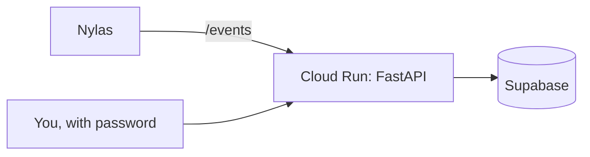

# Week 5: Deploy the Assistant

Run the assistant live on the internet, so new emails are processed without a tunnel or a laptop left on.

## Goals

1. Package the app with Docker and test the image locally.
2. Move the database to Supabase (hosted Postgres with pgvector).
3. Deploy the app to Google Cloud Run, with a fixed HTTPS URL for the Nylas webhook.
4. Keep it private: every page asks for a password, except `/events`, which checks the Nylas signature.

## Live Deployment

| | |
|---|---|
| App | [assistant-26484711792.europe-west3.run.app](https://assistant-26484711792.europe-west3.run.app) (any username, password is `APP_PASSWORD`) |
| Cloud Run | Service `assistant`, project `ai-personal-assistant-lp`, region `europe-west3` |
| Database | Supabase, Central EU (Frankfurt), table `listings` |



## Deploy, Step by Step

### 1. Test the Docker image locally

```bash
docker compose up -d
docker build -t assistant .
docker run --rm -p 8080:8080 --network ai-personal-assistant_default --env-file .env \
  -e PORT=8080 -e APP_PASSWORD=test \
  -e DATABASE_URL="postgresql://postgres:postgres@db:5432/postgres" \
  assistant
```

Open `http://localhost:8080`, log in with any username and `test`, then stop it with Ctrl+C.

### 2. Create a Google Cloud project

Create a project in the [Cloud Console](https://console.cloud.google.com) and link a billing account (a small budget alert is a good idea). Then:

```bash
gcloud auth login
gcloud config set project YOUR_PROJECT_ID
gcloud services enable run.googleapis.com cloudbuild.googleapis.com artifactregistry.googleapis.com
```

### 3. Create the Supabase database

Create a project at [supabase.com](https://supabase.com) in **Central EU (Frankfurt)**. Click **Connect**, copy the **Session pooler** string, and put in your database password. This is your `DATABASE_URL`. The app creates the `listings` table itself on start.

### 4. Write the Cloud Run settings

Create `cloudrun.env.yaml` in the repo root. Git ignores it, so secrets stay local.

```yaml
NYLAS_API_KEY: "..."
NYLAS_API_URI: "https://api.eu.nylas.com"
NYLAS_CLIENT_ID: "..."
NYLAS_GRANT_ID: "..."
OPENAI_API_KEY: "..."
DATABASE_URL: "your Supabase session pooler string"
APP_PASSWORD: "choose a password"
WEBHOOK_SECRET: ""
```

### 5. Deploy

```bash
gcloud run deploy assistant --source . --region europe-west3 \
  --allow-unauthenticated --no-cpu-throttling --max-instances 1 \
  --env-vars-file cloudrun.env.yaml
```

It prints the service URL. The flags:

- `--allow-unauthenticated`: lets Nylas reach `/events`. The app's password protects everything else.
- `--no-cpu-throttling`: lets the email finish processing after the app replies to Nylas.
- `--max-instances 1`: the main page keeps results in memory, so all requests must reach one instance.

### 6. Create the webhook

Set `SERVER_URL` in your local `.env` to the service URL, then:

```bash
cd app/config && uv run config_webhook.py
```

Put the printed secret into `WEBHOOK_SECRET` in `cloudrun.env.yaml` and load it:

```bash
gcloud run services update assistant --region europe-west3 --env-vars-file cloudrun.env.yaml
```

Delete any old tunnel webhook in the Nylas Dashboard.

### 7. Test

Send yourself an apartment listing email. Within about 20 seconds it appears on the main page, and its listings appear in Supabase under **Table Editor**, `listings`.

## Good to Know

- After about 15 idle minutes Cloud Run stops the app. The next request takes a few seconds, and the main page starts empty. Listings stay in Supabase, so `/search` and `/ask` still find them.
- To redeploy code, run step 5 again. To change a setting, edit `cloudrun.env.yaml` and run the update command from step 6.
- Logs: `gcloud run services logs read assistant --region europe-west3`
- Locally nothing changes: leave `APP_PASSWORD` empty and run the app as in [Week 4](https://github.com/lindseypeng/ai-personal-assistant/tree/week-4).
