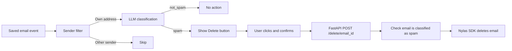

# Week 3: A Simple Spam Workflow

## This Week's Goals

1. **Build a spam workflow:** Take the emails you captured in Week 2, parse them with Pydantic, keep only emails sent from your own address, classify each one as spam or not spam with an LLM, and delete spam through Nylas after you confirm.
2. **Understand FastAPI:** Learn how FastAPI receives requests, validates data with Pydantic, and returns responses. Practice these concepts in the [FastAPI tutorial](week3/fastapi-tutorial/README.md).

## Before You Start: Recap Week 2

This week builds on the email capture setup from [Week 2](https://github.com/lindseypeng/ai-personal-assistant/blob/week-2/README.md). Make sure you can still capture emails with Nylas:

1. **Start a Cloudflare tunnel.** We now use Cloudflare instead of Serveo because it stays connected more reliably. Install it once with `brew install cloudflared` (Windows: `winget install --id Cloudflare.cloudflared`), then run `cloudflared tunnel --url http://localhost:8000` in a separate terminal and keep it open.
2. **Start `main.py`:** `cd app` then `uv run main.py`.
3. **Update the webhook.** The tunnel gets a new `trycloudflare.com` URL every time it starts, so delete the old webhook in the Nylas Dashboard, update `SERVER_URL`, create a new webhook, and restart `main.py` to load the new secret. See [Start a New Session](docs/start-new-session.md) for each step.
4. **Send yourself 2 to 3 sample spam emails** from the address in `EMAIL`. Check that each one is saved as JSON in `requests/events/`.
5. **Follow this week's slides** to build the workflow step by step.

If emails stop arriving, see the [Webhook Troubleshooting Guide](docs/webhook-troubleshoot-guide.md).

## Week 3 Workflow

FastAPI receives the Nylas webhook at `POST /events`, saves the event as JSON, and starts a background spam check. The diagram below shows what happens after capture.



In the web app, the Delete button asks for confirmation before submitting to FastAPI. The endpoint checks that the email is already classified as spam, then calls the Nylas SDK. Nylas itself does not require a user click. The confirmation comes from our application. Protect the delete endpoint before running the app long term.

The sender filter only lets through emails from your own address. While you are learning, this keeps the workflow on test emails you control, so a wrong classification can never delete a real email from someone else.

## Part 1: Run the Spam Workflow

The workflow lives in `app/workflows/spam_workflow.py`. It needs `OPENAI_API_KEY` in `.env`.

**In the browser:** With `main.py` and the tunnel running, send yourself a spam email and refresh `http://localhost:8000`. Emails classified as spam show a Delete button.

**From the terminal:** Run the workflow on one saved event. Use a file name from `requests/events/` without `.json`:

```bash
uv run app/workflows/spam_workflow.py <event_id>
```

The script prints the category and confidence, then asks before it deletes anything.

## Part 2: Practice FastAPI

The `week3/fastapi-tutorial/` folder is a small standalone FastAPI app. It covers routers, Pydantic request validation, GET vs POST, sync vs async endpoints, and Bearer token authentication.

Stop `app/main.py` first, since both apps use port 8000. Then run:

```bash
cd week3/fastapi-tutorial
uv run uvicorn main:app --reload
```

Open `http://localhost:8000/docs` to try the endpoint, or run `uv run request.py` from the same folder in another terminal. See the [FastAPI tutorial README](week3/fastapi-tutorial/README.md) for the full walkthrough.
